  

[Portfolio](https://mehulcodr.github.io/) &nbsp;·&nbsp; [LinkedIn](https://www.linkedin.com/in/mehul-gupta-412666326/) &nbsp;·&nbsp; [LeetCode](https://leetcode.com/u/Mehul_018/) &nbsp;·&nbsp; [Codeforces](https://codeforces.com/profile/mehulgupta0910) &nbsp;·&nbsp; [Email](mailto:mehulgupta0910@gmail.com)

